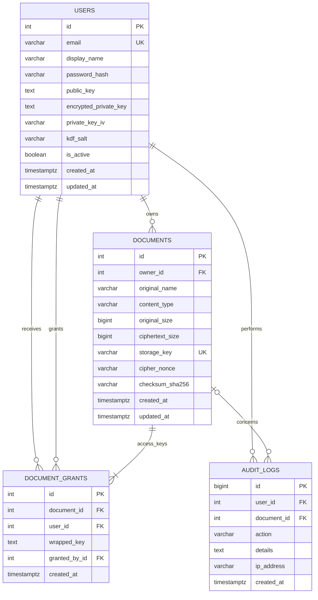

# VaultShare database design

PostgreSQL schema managed by Alembic. The complete initial DDL is [migration 0001](../server/migrations/versions/0001_initial_schema.py).

## Tables

- **users** — credentials hashed with Argon2id; RSA public key and password-encrypted PKCS#8 private-key bundle. The server does not receive the private key in plaintext.
- **documents** — encrypted-file metadata and opaque storage key. The actual encrypted bytes live in the encrypted-file volume, not a database BLOB.
- **document_grants** — one row per user with access to a document, including the RSA-OAEP wrapped AES file key. Owner access is also a grant. `(document_id, user_id)` is unique.
- **audit_logs** — account, upload, share, download, verification and delete events. File names and recipients may be in event details, so protect access to this table.

Deleting a user cascades their owned documents and grants. Deleting a document cascades its grants; audit references become null to retain the audit event. Backups must cover PostgreSQL and the encrypted-file volume together.
