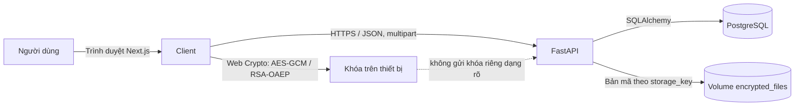
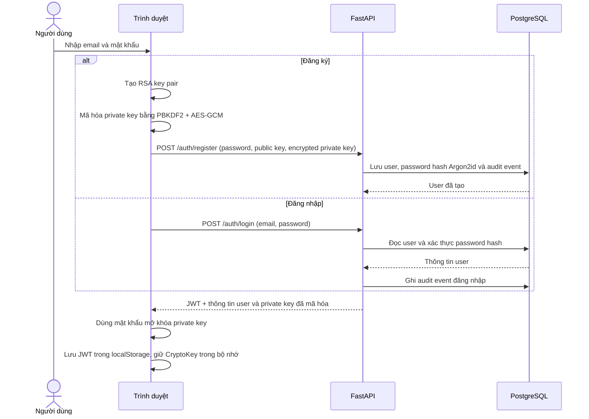
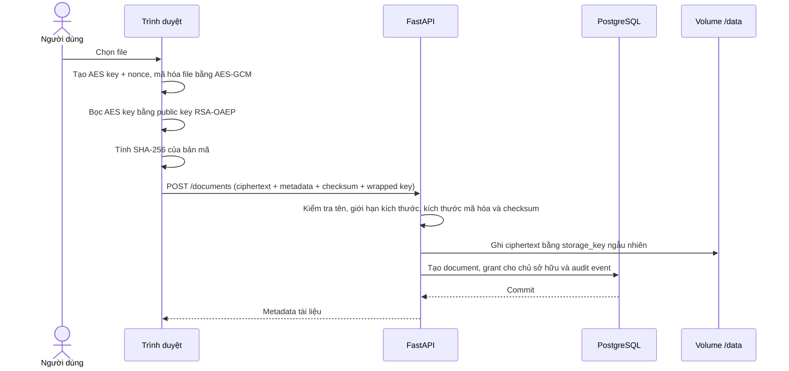
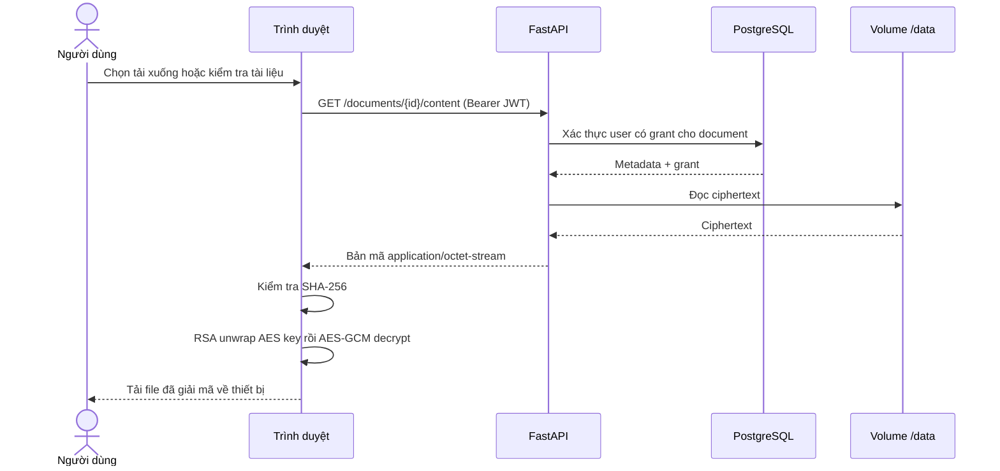
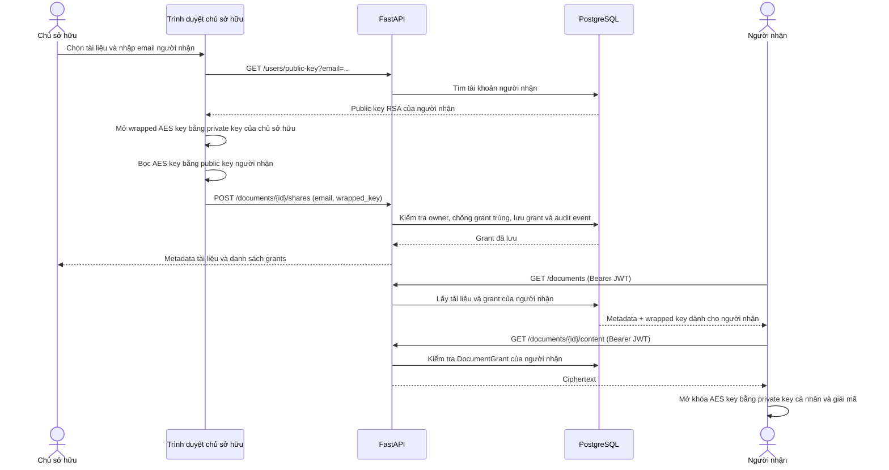
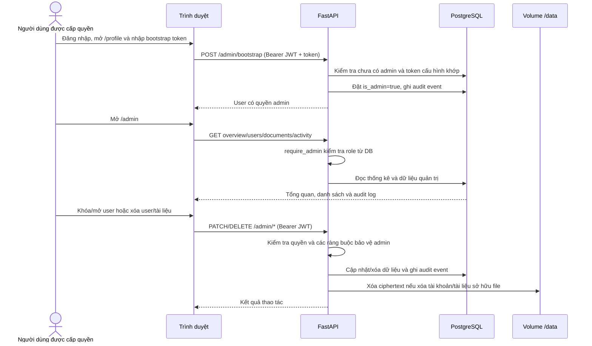

# Luồng hoạt động chính

Tài liệu này mô tả các luồng đang được triển khai trong VaultShare. Mã hóa và giải mã nội dung tệp chạy ở trình duyệt; API chỉ nhận và lưu bản mã.

## Tổng quan hệ thống

- **Client** quản lý giao diện, JWT phiên, mã hóa/giải mã và khóa riêng đã được mở khóa trong bộ nhớ.
- **API** xác thực người dùng, kiểm tra quyền sở hữu/chia sẻ, kiểm tra checksum, lưu metadata và audit log.
- **PostgreSQL** lưu tài khoản, metadata tài liệu, grants và sự kiện.
- **Volume `encrypted_files`** lưu byte bản mã. `storage_key` là tên ngẫu nhiên, không phải tên file gốc.

## Đăng ký và đăng nhập

Khi đăng ký, trình duyệt tạo cặp khóa RSA. Khóa riêng được mã hóa bằng AES-GCM với khóa dẫn xuất từ mật khẩu qua PBKDF2; API chỉ nhận khóa riêng ở dạng đã mã hóa. Khi đăng nhập, API xác thực mật khẩu rồi trả thông tin khóa đã mã hóa để trình duyệt mở khóa cục bộ.

Sau khi tải lại trang, CryptoKey trong bộ nhớ không còn. Client xóa phiên đã lưu và yêu cầu đăng nhập lại để mở khóa; private key không được lưu dạng rõ trong localStorage.

## Tải lên tài liệu

Mỗi file có khóa AES-GCM riêng. Client mã hóa file, bọc khóa AES bằng public key RSA của người dùng, rồi gửi bản mã cùng metadata và checksum. API giới hạn bản mã ở `MAX_UPLOAD_BYTES` (Compose mặc định 100 MiB), xác nhận kích thước và SHA-256 trước khi lưu.

Nếu kiểm tra upload thất bại, API rollback transaction và xóa file bản mã tạm. `content_type` và tên gốc chỉ là metadata do client gửi; nội dung được lưu dưới dạng ciphertext.

## Tải xuống và xác minh

API chỉ trả bản mã cho người dùng có `DocumentGrant`. Trình duyệt xác minh checksum, mở khóa AES bằng private key và giải mã AES-GCM; sau đó tải file rõ về thiết bị. Luồng xác minh lưu trữ chỉ so checksum trên server, còn màn hình client có thể tải bản mã về để xác thực checksum và thẻ GCM.

Endpoint `POST /documents/{id}/verify` đọc file trong volume và so SHA-256 với checksum đã lưu; kết quả được ghi vào audit log.

## Chia sẻ tài liệu

Chỉ chủ sở hữu được cấp quyền chia sẻ. Server không chuyển private key hoặc plaintext AES key. Client của chủ sở hữu mở khóa AES key hiện có bằng private key, bọc lại AES key với public key của người nhận, rồi API lưu grant mới.

## Quản trị hệ thống

Admin đầu tiên được bootstrap bằng token cấu hình phía server, sau khi đăng nhập và khi hệ thống chưa có admin. Tất cả endpoint `/admin/*` còn lại dùng dependency `require_admin`; ẩn đường dẫn trên client không thay thế kiểm tra quyền ở API.

## Endpoint tham chiếu

| Luồng | Endpoint chính |
| --- | --- |
| Đăng ký / đăng nhập | `POST /api/v1/auth/register`, `POST /api/v1/auth/login` |
| Hồ sơ | `GET/PATCH /api/v1/auth/me` |
| Bootstrap admin | `POST /api/v1/admin/bootstrap` |
| Upload / danh sách / download | `POST/GET /api/v1/documents`, `GET /api/v1/documents/{id}/content` |
| Xác minh checksum | `POST /api/v1/documents/{id}/verify` |
| Chia sẻ | `GET /api/v1/users/public-key`, `POST /api/v1/documents/{id}/shares` |
| Quản trị | `/api/v1/admin/overview`, `/users`, `/documents`, `/activity` |
